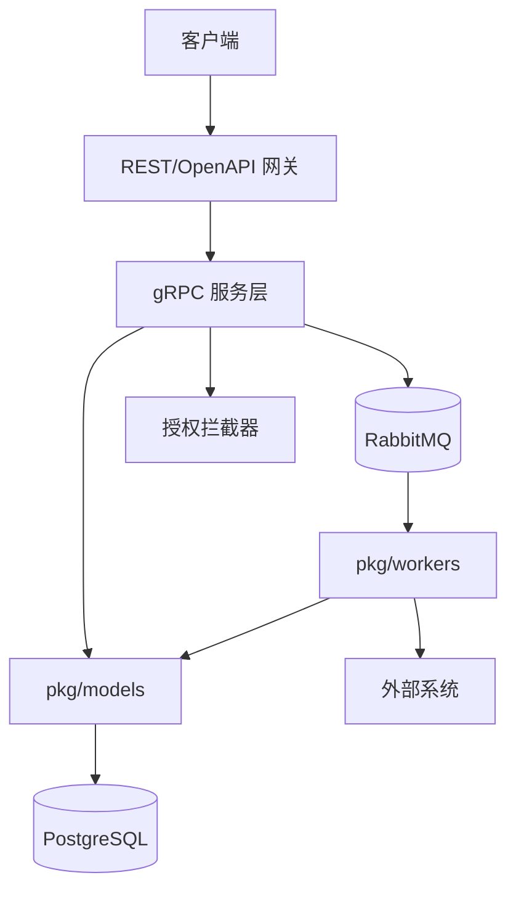
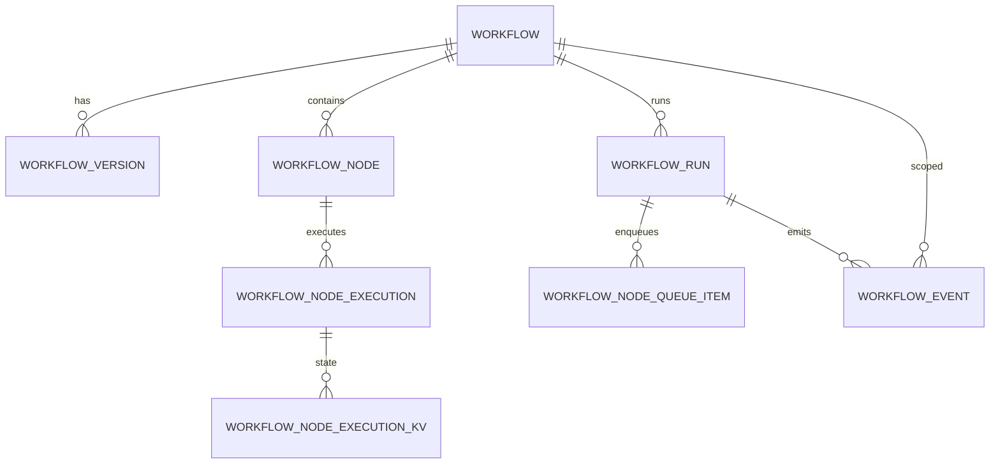
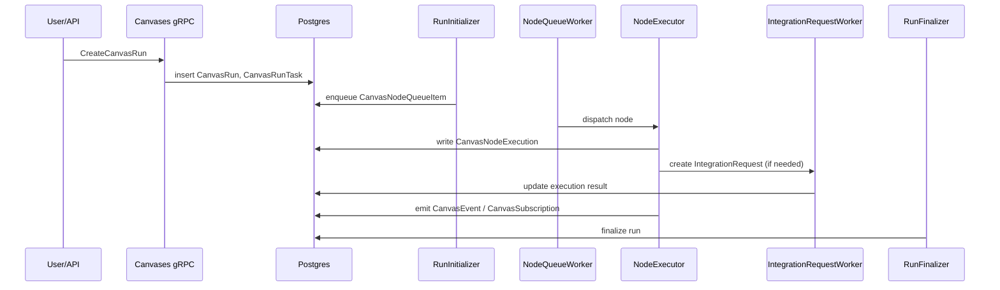
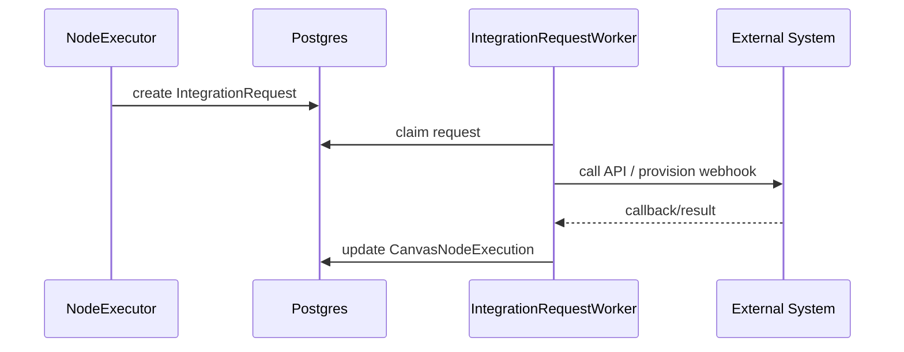
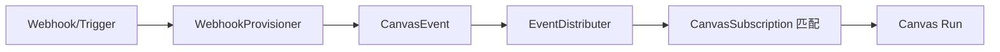
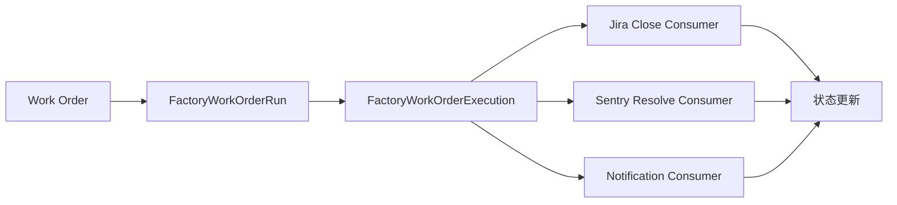
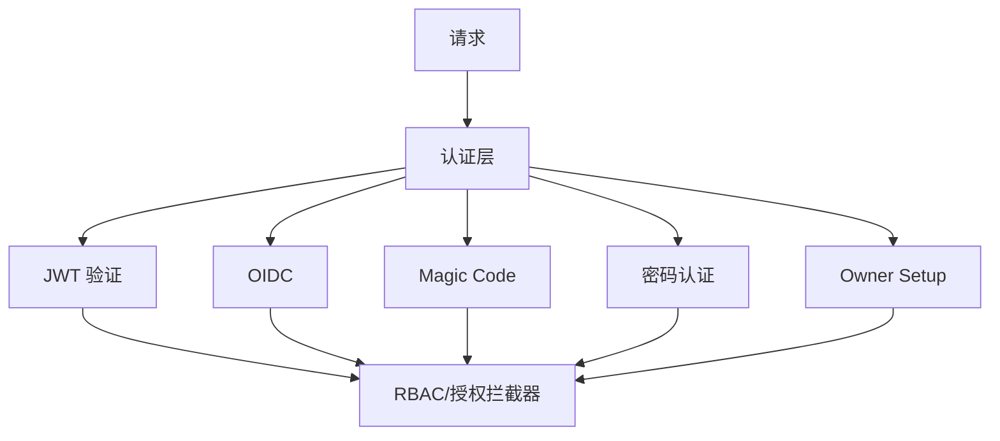
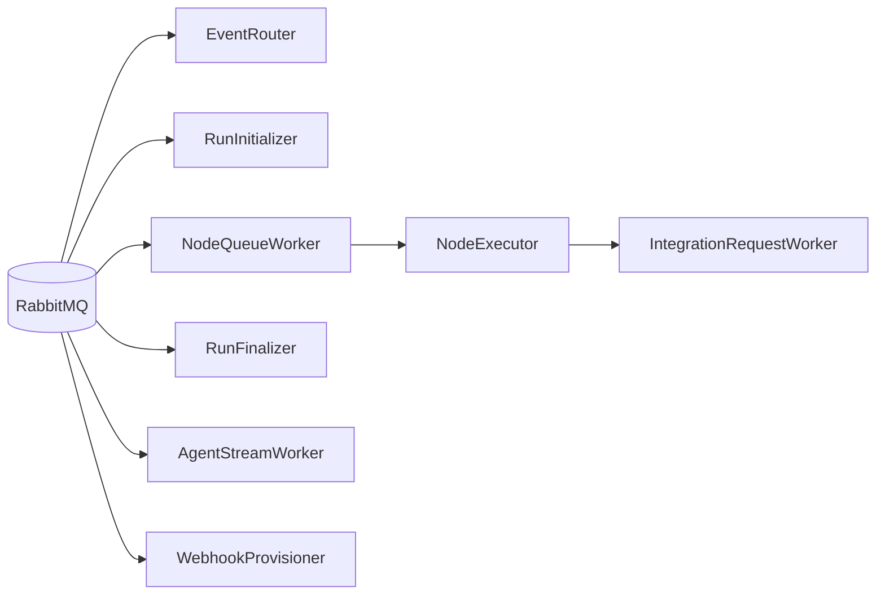
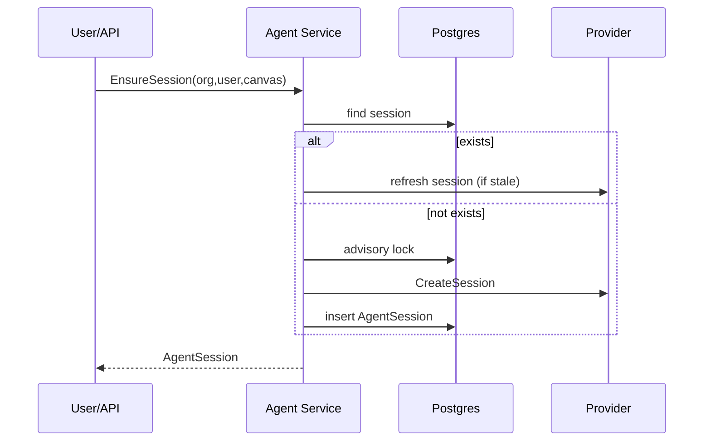
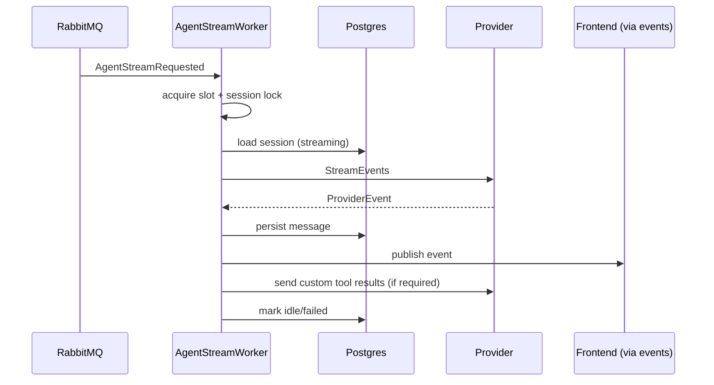

# SuperPlane 后端：数据建模与主要交互流程（调研报告）

源仓库：[superplanehq/superplane](https://github.com/superplanehq/superplane)，分支 `main`。

## 1. 总览

SuperPlane 后端是 Go 应用，暴露 gRPC API（带 REST/OpenAPI 网关），使用 PostgreSQL 持久化状态，RabbitMQ 驱动异步 worker。核心领域是 **Canvas 执行引擎**（画布、节点、运行、事件），辅以组织/权限、集成、密钥、Factory 流水线、Agent 会话、计费与 Runner/Fleet。

入口：`cmd/server/main.go` → `pkg/server.Start()`（`pkg/server/server.go:751`）。

## 2. 架构分层

| 层 | 目录 | 职责 |
|---|---|---|
| API | `protos/*.proto`, `pkg/grpc/actions/*` | gRPC 服务 + REST 网关 |
| 领域模型 | `pkg/models/*` | GORM 实体与 DB 访问 |
| 异步 | `pkg/workers/*` | RabbitMQ 消费者/定时任务 |
| 集成 | `pkg/integrations/*`, `pkg/registry/*` | 外部系统适配 |
| 授权 | `pkg/authorization/*`, `rbac/*` | 鉴权与 RBAC |
| 基础设施 | `pkg/database`, `pkg/crypto`, `pkg/blob`, `pkg/llm` | 存储/加密/LLM |

gRPC 服务（来自 `protos/*.proto`）：Organizations, Users, Groups, Roles, ApiKeys, Me, Canvases, Triggers, Integrations, Secrets, Agents, Factories, Files, Widgets, Configuration, Components, Actions。

### 架构总览



### C4 容器图（D2）

```d2
direction: down

client: Client {
  shape: person
}

gateway: REST/OpenAPI Gateway {
  shape: rectangle
}

grpc: gRPC Services {
  shape: rectangle
}

models: Domain Models (pkg/models) {
  shape: rectangle
}

pg: PostgreSQL {
  shape: cylinder
}

mq: RabbitMQ {
  shape: cylinder
}

workers: Background Workers (pkg/workers) {
  shape: rectangle
}

ext: External Systems {
  shape: cloud
}

client -> gateway: HTTP/REST
gateway -> grpc: gRPC
grpc -> models: queries/writes
models -> pg: SQL
grpc -> mq: publish
mq -> workers: consume
workers -> models: update state
workers -> ext: API calls
```

## 3. 数据建模

### 3.1 组织 / 用户 / 账号 / 权限

- `Account`, `AccountLinkedAccount`, `AccountMagicCode`, `AccountPasswordAuth`, `AccountBlock`
- `Organization`, `OrganizationInvitation`, `OrganizationInviteLink`, `OrganizationBillingPlan`, `OrganizationExperimentalFeatures`, `OrganizationHostedModelAllowlist`
- `User`, `Group`, `Role`, `ApiKey`
- 计费/额度：`BillingPlan`, `CreditPack`, `OrganizationLLMCredit` / `...Spend` / `...Adjustment`, `Usage`, `Entitlements`, `Licensing`

### 3.2 Canvas 与执行

| 实体 | 文件 | 说明 |
|---|---|---|
| `Canvas` | `pkg/models/canvas.go:32` | 画布 |
| `CanvasVersion` / `CanvasVersionMetadata` | `pkg/models/canvas_version.go` | 版本化定义 |
| `CanvasNode` | `pkg/models/canvas_node.go:111` | 节点 |
| `CanvasNodeQueueItem` | `pkg/models/canvas_node.go:592` | 调度队列 |
| `CanvasNodeRequest` | `pkg/models/canvas_node_request.go` | 节点请求 |
| `CanvasNodeExecution` | `pkg/models/canvas_node_execution.go:44` | 执行实例 |
| `CanvasNodeExecutionKV` | `pkg/models/canvas_node_execution_kvs.go:23` | KV 状态 |
| `CanvasRun` / `CanvasRunTask` / `CanvasRunTaskLabel` / `CanvasRunKey` | `pkg/models/canvas_run.go:34` | 运行与任务 |
| `CanvasEvent` | `pkg/models/canvas_event.go:18` | 事件 |
| `CanvasSubscription` | `pkg/models/canvas_subscription.go:8` | 订阅 |
| `CanvasMemory` | `pkg/models/canvas_memory.go:19` | 画布记忆 |

### Canvas 域关系



### 3.3 事件 / 触发器

- `CanvasEvent`, `CanvasSubscription`：画布内事件分发
- `Trigger`（`triggers.proto`）：外部触发器与 provisioning（`WebhookProvisioner` worker）
- `EventRouter` / `EventDistributer` worker：事件路由

### 3.4 集成 / 密钥 / 配置

- `Integration`, `IntegrationName`, `IntegrationRequest`, `IntegrationSubscription`
- `Secret`（`secrets.proto`）
- `StoredFiles` / `Files`
- `Configuration`, `Components`, `Widgets`
- Forge 安装：`BitbucketForgeInstallation` 等

### 3.5 Factory（自动化流水线）

- `FactoryWorkOrder`, `FactoryWorkOrderRun`, `FactoryWorkOrderExecution`, `FactoryWorkOrderEvent`, `FactoryAutomationRuns`
- Consumers：Jira close、Sentry resolve、notification；velocity sync、cleanup

### 3.6 Agent / LLM 会话

- `AgentSession`, `AgentSessionMessage`
- `ClaudeModelAlias`
- `AgentStreamWorker` 流式输出

### 3.7 Runner / Fleet

- `Runners`, `Fleets`
- `RunnerRegistrationCleanupWorker`, `RunnerTaskLogCompactor`

### 3.8 持久化与事务约定

- 模型函数第一参数为 `*gorm.DB`（显式传递），避免 `database.Conn()`；调用方用 `database.DB(ctx)`。
- 事务：`database.DB(ctx).Transaction(func(tx *gorm.DB) error {...})`。
- 迁移：`db/migrations/*.up.sql`（down 为空），结构快照 `db/structure.sql`；创建迁移用 `make db.migration.create NAME=...`。

### 3.9 数据表设计（SQL DDL）

#### 账号与组织

```sql
CREATE TABLE accounts (
  id uuid DEFAULT public.uuid_generate_v4() NOT NULL,
  email character varying(255) NOT NULL,
  name character varying(255) NOT NULL,
  created_at timestamp without time zone DEFAULT CURRENT_TIMESTAMP NOT NULL,
  updated_at timestamp without time zone DEFAULT CURRENT_TIMESTAMP NOT NULL,
  installation_admin boolean DEFAULT false NOT NULL,
  password_changed_at timestamp with time zone,
  blocked_at timestamp with time zone,
  deleted_at timestamp with time zone,
  welcome_credit_granted_at timestamp with time zone
);

CREATE TABLE users (
  id uuid DEFAULT public.uuid_generate_v4() NOT NULL,
  account_id uuid,
  name character varying(255),
  email character varying(255),
  created_at timestamp without time zone DEFAULT CURRENT_TIMESTAMP,
  updated_at timestamp without time zone DEFAULT CURRENT_TIMESTAMP,
  deleted_at timestamp without time zone,
  organization_id uuid NOT NULL,
  token_hash character varying(250),
  type character varying(50) DEFAULT 'human'::character varying NOT NULL,
  description text,
  created_by uuid,
  api_key_expires_at timestamp without time zone,
  api_key_canvas_ids jsonb DEFAULT '[]'::jsonb NOT NULL,
  is_owner boolean DEFAULT false NOT NULL
);

CREATE TABLE organizations (
  id uuid DEFAULT public.uuid_generate_v4() NOT NULL,
  name character varying(255) NOT NULL,
  allowed_providers jsonb DEFAULT '[]'::jsonb NOT NULL,
  created_at timestamp without time zone DEFAULT CURRENT_TIMESTAMP,
  updated_at timestamp without time zone DEFAULT CURRENT_TIMESTAMP,
  deleted_at timestamp without time zone,
  description text DEFAULT ''::text,
  usage_retention_window_days integer DEFAULT 180,
  enabled_experimental_features jsonb DEFAULT '[]'::jsonb NOT NULL,
  slug text NOT NULL,
  created_by_account_id uuid
);

CREATE TABLE secrets (
  id uuid DEFAULT public.uuid_generate_v4() NOT NULL,
  name character varying(128) NOT NULL,
  created_at timestamp without time zone NOT NULL,
  updated_at timestamp without time zone NOT NULL,
  created_by uuid NOT NULL,
  provider character varying(64) NOT NULL,
  data bytea NOT NULL,
  domain_type character varying(64) NOT NULL,
  domain_id character varying(64) NOT NULL
);
```

#### Canvas / Workflow 执行域

```sql
CREATE TABLE workflows (
  id uuid DEFAULT public.uuid_generate_v4() NOT NULL,
  organization_id uuid NOT NULL,
  name character varying(128) NOT NULL,
  created_at timestamp without time zone NOT NULL,
  updated_at timestamp without time zone NOT NULL,
  created_by uuid,
  deleted_at timestamp without time zone,
  live_version_id uuid NOT NULL,
  description text DEFAULT ''::text NOT NULL,
  dismissed_agent_suggestion_ids jsonb DEFAULT '[]'::jsonb NOT NULL,
  factory_id uuid,
  column_key text
);

CREATE TABLE workflow_versions (
  id uuid DEFAULT public.uuid_generate_v4() NOT NULL,
  workflow_id uuid NOT NULL,
  owner_id uuid,
  nodes jsonb DEFAULT '[]'::jsonb NOT NULL,
  edges jsonb DEFAULT '[]'::jsonb NOT NULL,
  created_at timestamp without time zone NOT NULL,
  updated_at timestamp without time zone NOT NULL,
  console_panels jsonb DEFAULT '[]'::jsonb NOT NULL,
  console_layout jsonb DEFAULT '[]'::jsonb NOT NULL,
  commit_sha character varying(40) DEFAULT ''::character varying NOT NULL,
  commit_message text DEFAULT ''::text NOT NULL
);

CREATE TABLE workflow_nodes (
  workflow_id uuid NOT NULL,
  node_id character varying(128) NOT NULL,
  name character varying(128) NOT NULL,
  state character varying(32) NOT NULL,
  type character varying(32) NOT NULL,
  ref jsonb NOT NULL,
  configuration jsonb DEFAULT '{}'::jsonb NOT NULL,
  created_at timestamp without time zone NOT NULL,
  updated_at timestamp without time zone NOT NULL,
  webhook_id uuid,
  metadata jsonb DEFAULT '{}'::jsonb NOT NULL,
  "position" jsonb DEFAULT '{}'::jsonb NOT NULL,
  is_collapsed boolean DEFAULT false NOT NULL,
  deleted_at timestamp with time zone,
  app_installation_id uuid,
  state_reason text,
  concurrency_key text,
  concurrency_max integer
);

CREATE TABLE workflow_runs (
  id uuid DEFAULT public.uuid_generate_v4() NOT NULL,
  workflow_id uuid NOT NULL,
  state character varying(32) NOT NULL,
  result character varying(32),
  created_at timestamp without time zone NOT NULL,
  updated_at timestamp without time zone NOT NULL,
  finished_at timestamp without time zone,
  version_id uuid NOT NULL,
  cancelled_at timestamp without time zone,
  cancelled_by uuid,
  node_id character varying(128),
  parent_run_id uuid,
  parent_workflow_id uuid,
  parent_execution_id uuid,
  callbacks jsonb DEFAULT '[]'::jsonb NOT NULL,
  input jsonb DEFAULT '{}'::jsonb NOT NULL,
  errors jsonb DEFAULT '[]'::jsonb NOT NULL
);

CREATE TABLE workflow_node_queue_items (
  id uuid DEFAULT public.uuid_generate_v4() NOT NULL,
  workflow_id uuid NOT NULL,
  node_id character varying(128) NOT NULL,
  root_event_id uuid,
  event_id uuid,
  created_at timestamp without time zone NOT NULL,
  run_id uuid NOT NULL,
  queue_name character varying(256)
);

CREATE TABLE workflow_node_executions (
  id uuid DEFAULT public.uuid_generate_v4() NOT NULL,
  workflow_id uuid NOT NULL,
  node_id character varying(128) NOT NULL,
  root_event_id uuid,
  event_id uuid,
  previous_execution_id uuid,
  state character varying(32) NOT NULL,
  result character varying(32),
  result_reason character varying(128),
  result_message text,
  metadata jsonb DEFAULT '{}'::jsonb NOT NULL,
  configuration jsonb DEFAULT '{}'::jsonb NOT NULL,
  created_at timestamp without time zone NOT NULL,
  updated_at timestamp without time zone NOT NULL,
  cancelled_by uuid,
  run_id uuid NOT NULL,
  cancelled_at timestamp without time zone,
  queue_name character varying(256)
);

CREATE TABLE workflow_node_execution_kvs (
  id uuid DEFAULT gen_random_uuid() NOT NULL,
  execution_id uuid NOT NULL,
  key text NOT NULL,
  value text NOT NULL,
  created_at timestamp with time zone DEFAULT now() NOT NULL,
  workflow_id uuid NOT NULL,
  node_id character varying(128) NOT NULL
);

CREATE TABLE workflow_node_requests (
  id uuid DEFAULT public.uuid_generate_v4() NOT NULL,
  workflow_id uuid NOT NULL,
  execution_id uuid,
  state character varying(32) NOT NULL,
  type character varying(32) NOT NULL,
  spec jsonb NOT NULL,
  run_at timestamp without time zone NOT NULL,
  created_at timestamp without time zone NOT NULL,
  updated_at timestamp without time zone NOT NULL,
  node_id character varying(128) NOT NULL
);

CREATE TABLE workflow_events (
  id uuid DEFAULT public.uuid_generate_v4() NOT NULL,
  workflow_id uuid NOT NULL,
  node_id character varying(128),
  channel character varying(64),
  data jsonb NOT NULL,
  state character varying(32) NOT NULL,
  execution_id uuid,
  created_at timestamp without time zone NOT NULL,
  custom_name text,
  run_id uuid NOT NULL,
  dedup_key text
);

CREATE TABLE workflow_staged_files (
  id uuid DEFAULT public.uuid_generate_v4() NOT NULL,
  base_version_id uuid NOT NULL,
  organization_id uuid NOT NULL,
  path text NOT NULL,
  content text DEFAULT ''::text NOT NULL,
  deleted boolean DEFAULT false NOT NULL,
  updated_at timestamp with time zone DEFAULT now() NOT NULL,
  user_id uuid NOT NULL,
  workflow_id uuid NOT NULL
);

CREATE TABLE canvas_memories (
  canvas_id uuid NOT NULL,
  namespace text NOT NULL,
  "values" jsonb NOT NULL,
  id uuid DEFAULT gen_random_uuid() NOT NULL,
  created_at timestamp with time zone DEFAULT now() NOT NULL,
  updated_at timestamp with time zone DEFAULT now() NOT NULL,
  source text DEFAULT 'node'::text NOT NULL
);

CREATE TABLE canvas_subscriptions (
  source_canvas_id uuid NOT NULL,
  target_canvas_id uuid NOT NULL,
  target_node_id character varying(128) NOT NULL
);
```

#### 集成与安装

```sql
CREATE TABLE app_installations (
  id uuid DEFAULT public.uuid_generate_v4() NOT NULL,
  organization_id uuid NOT NULL,
  app_name character varying(255) NOT NULL,
  installation_name character varying(255) NOT NULL,
  state character varying(32) NOT NULL,
  state_description character varying(1024),
  configuration jsonb DEFAULT '{}'::jsonb NOT NULL,
  metadata jsonb DEFAULT '{}'::jsonb NOT NULL,
  browser_action jsonb,
  created_at timestamp without time zone NOT NULL,
  updated_at timestamp without time zone NOT NULL,
  deleted_at timestamp with time zone,
  capabilities jsonb DEFAULT '[]'::jsonb NOT NULL,
  properties jsonb DEFAULT '[]'::jsonb NOT NULL,
  setup_state jsonb
);

CREATE TABLE app_installation_requests (
  id uuid DEFAULT public.uuid_generate_v4() NOT NULL,
  app_installation_id uuid NOT NULL,
  state character varying(32) NOT NULL,
  type character varying(32) NOT NULL,
  run_at timestamp without time zone NOT NULL,
  created_at timestamp without time zone NOT NULL,
  updated_at timestamp without time zone NOT NULL,
  spec jsonb
);
```

#### Agent 与 LLM

```sql
CREATE TABLE agent_sessions (
  id uuid DEFAULT public.uuid_generate_v4() NOT NULL,
  organization_id uuid NOT NULL,
  user_id uuid NOT NULL,
  canvas_id uuid NOT NULL,
  provider character varying(40) NOT NULL,
  provider_session_id text NOT NULL,
  status character varying(40) DEFAULT 'idle'::character varying NOT NULL,
  last_active_at timestamp with time zone,
  created_at timestamp with time zone DEFAULT now() NOT NULL,
  updated_at timestamp with time zone DEFAULT now() NOT NULL,
  heartbeat_at timestamp with time zone,
  agent_tool_schema_revision text DEFAULT ''::text NOT NULL,
  context_replayed_at timestamp with time zone
);

CREATE TABLE agent_session_messages (
  id uuid DEFAULT public.uuid_generate_v4() NOT NULL,
  session_id uuid NOT NULL,
  provider_event_id text DEFAULT ''::text NOT NULL,
  role character varying(20) NOT NULL,
  content text DEFAULT ''::text NOT NULL,
  tool_call_id text DEFAULT ''::text NOT NULL,
  tool_name text DEFAULT ''::text NOT NULL,
  tool_status character varying(20) DEFAULT ''::character varying NOT NULL,
  created_at timestamp with time zone DEFAULT now() NOT NULL,
  images jsonb DEFAULT '[]'::jsonb NOT NULL
);
```

#### Factory 流水线

```sql
CREATE TABLE factories (
  id uuid DEFAULT public.uuid_generate_v4() NOT NULL,
  organization_id uuid NOT NULL,
  name text NOT NULL,
  description text DEFAULT ''::text NOT NULL,
  created_at timestamp with time zone DEFAULT now() NOT NULL,
  updated_at timestamp with time zone DEFAULT now() NOT NULL,
  deleted_at timestamp with time zone,
  key character varying(5) NOT NULL,
  next_work_order_number bigint DEFAULT 1 NOT NULL,
  onboarding_completed_at timestamp with time zone,
  onboarding_config jsonb DEFAULT '{}'::jsonb NOT NULL,
  hosted_spend_budget_cents bigint,
  planning_enabled boolean DEFAULT true NOT NULL,
  planning_clarity boolean DEFAULT false NOT NULL,
  planning_confidence boolean DEFAULT true NOT NULL,
  planning_setup_completed boolean DEFAULT false NOT NULL,
  planning_auto_start_line_id uuid,
  public boolean DEFAULT false NOT NULL,
  public_badge_enabled boolean DEFAULT false NOT NULL,
  public_badge_show_cost boolean DEFAULT false NOT NULL,
  public_badge_token text,
  url_id text NOT NULL
);

CREATE TABLE factory_work_orders (
  id uuid DEFAULT public.uuid_generate_v4() NOT NULL,
  organization_id uuid NOT NULL,
  factory_id uuid NOT NULL,
  title text NOT NULL,
  description text DEFAULT ''::text NOT NULL,
  state character varying(32) DEFAULT 'draft'::character varying NOT NULL,
  result character varying(32) DEFAULT ''::character varying NOT NULL,
  created_by_id uuid,
  created_at timestamp with time zone DEFAULT now() NOT NULL,
  updated_at timestamp with time zone DEFAULT now() NOT NULL,
  source_run_id uuid,
  number bigint NOT NULL,
  status_note jsonb,
  origin_url text,
  origin_label text,
  repository text,
  default_branch text,
  auto_start_line_id uuid,
  mcp_client_id text,
  mcp_client_name text,
  vcs_provider text,
  refinement_model text
);
```

#### Runner / Fleet

```sql
CREATE TABLE runners (
  id uuid DEFAULT public.uuid_generate_v4() NOT NULL,
  fleet_id uuid NOT NULL,
  state character varying(32) DEFAULT 'pending'::character varying NOT NULL,
  runner_version text NOT NULL,
  ephemeral boolean DEFAULT false NOT NULL,
  creation_idempotency_key text,
  creation_request_hash text,
  registered_at timestamp with time zone,
  last_seen_at timestamp with time zone,
  current_connection_id uuid,
  termination_reason text,
  created_at timestamp with time zone DEFAULT now() NOT NULL,
  updated_at timestamp with time zone DEFAULT now() NOT NULL,
  terminated_at timestamp with time zone,
  tags jsonb DEFAULT '{}'::jsonb NOT NULL,
  os text DEFAULT ''::text NOT NULL,
  arch text DEFAULT ''::text NOT NULL,
  hostname text DEFAULT ''::text NOT NULL,
  ip text DEFAULT ''::text NOT NULL
);

CREATE TABLE runner_tasks (
  id uuid DEFAULT public.uuid_generate_v4() NOT NULL,
  organization_id uuid NOT NULL,
  fleet_id uuid NOT NULL,
  runner_id uuid,
  backend character varying(32) NOT NULL,
  state character varying(32) DEFAULT 'queued'::character varying NOT NULL,
  payload_ciphertext bytea NOT NULL,
  result jsonb,
  exit_code integer,
  error_message text,
  completion_hash text,
  cancel_requested_at timestamp with time zone,
  queued_at timestamp with time zone DEFAULT now() NOT NULL,
  reserved_at timestamp with time zone,
  started_at timestamp with time zone,
  finished_at timestamp with time zone,
  created_at timestamp with time zone DEFAULT now() NOT NULL,
  updated_at timestamp with time zone DEFAULT now() NOT NULL
);
```

#### 计费与用量

```sql
CREATE TABLE billing_plans (
  id uuid DEFAULT public.uuid_generate_v4() NOT NULL,
  key text NOT NULL,
  name text NOT NULL,
  category text NOT NULL,
  visibility text DEFAULT 'private'::text NOT NULL,
  price_cents bigint DEFAULT 0 NOT NULL,
  per_seat boolean DEFAULT false NOT NULL,
  polar_product_id text,
  seat_limit integer,
  parallel_task_limit integer,
  credit_amount_cents bigint DEFAULT 0 NOT NULL,
  credit_frequency text DEFAULT 'none'::text NOT NULL,
  credit_expiration text DEFAULT 'never'::text NOT NULL,
  credit_validity_days integer,
  trial_credit_cents bigint DEFAULT 0 NOT NULL,
  trial_length_days integer DEFAULT 14 NOT NULL,
  markup_bps integer,
  features jsonb DEFAULT '[]'::jsonb NOT NULL,
  require_payment_method boolean DEFAULT false NOT NULL,
  created_at timestamp with time zone DEFAULT now() NOT NULL,
  updated_at timestamp with time zone DEFAULT now() NOT NULL
);

CREATE TABLE organization_billing_plans (
  organization_id uuid NOT NULL,
  plan text NOT NULL,
  plan_source text DEFAULT ''::text NOT NULL,
  polar_subscription_id text,
  polar_subscription_status text DEFAULT ''::text NOT NULL,
  current_period_start timestamp with time zone,
  current_period_end timestamp with time zone,
  trial_started_at timestamp with time zone,
  trial_ends_at timestamp with time zone,
  updated_at timestamp with time zone DEFAULT now() NOT NULL,
  cancel_at_period_end boolean DEFAULT false NOT NULL,
  polar_modified_at timestamp with time zone,
  plan_id uuid NOT NULL,
  purchased_seats integer
);

CREATE TABLE usage_price_books (
  version text NOT NULL,
  effective_at timestamp with time zone NOT NULL,
  created_at timestamp with time zone DEFAULT now() NOT NULL,
  is_current boolean DEFAULT false NOT NULL
);
```

## 4. 主要交互流程

### 4.1 请求链路（gRPC + REST）

1. 客户端 → REST 网关 / gRPC → `pkg/grpc/actions/*` handler
2. Handler 调 `database.DB(ctx)`，调 `pkg/models` 查询/写入，必要时包事务
3. 授权拦截器 `pkg/authorization/interceptor.go` 校验权限
4. 返回 protobuf 响应（protojson 转 JSON）

### 4.2 Canvas 运行流程



### 4.3 集成请求流程



### 4.4 事件路由

外部触发器/webhook → `Trigger` provisioning（`WebhookProvisioner`）→ 产生事件 → `EventDistributer` → `CanvasSubscription` 匹配 → 触发 Canvas Run。


### 4.5 Factory 流水线

Work Order 创建 → `FactoryWorkOrderRun` / `Execution` → 多 consumer worker（Jira close、Sentry resolve、notification）→ 状态更新与通知。


### 4.6 Agent 会话

`Agents` service 创建会话 → `AgentSession` / `AgentSessionMessage`；`AgentStreamWorker` 流式推送。

### 4.7 认证

`auth/`, `jwt/`, `oidc/`, magic code, account password auth；owner setup 模式。


## 5. Worker 拓扑（环境变量开关）

| Worker | Env Gate |
|---|---|
| EventRouter | `START_WORKFLOW_EVENT_ROUTER` / `START_EVENT_ROUTER` |
| RunInitializer | `START_RUN_INITIALIZER` |
| NodeQueueWorker | `START_WORKFLOW_NODE_QUEUE_WORKER` / `START_NODE_QUEUE_WORKER` |
| NodeExecutor | `START_WORKFLOW_NODE_EXECUTOR` / `START_NODE_EXECUTOR` |
| IntegrationRequestWorker | `START_APP_INSTALLATION_REQUEST_WORKER` / `START_INTEGRATION_REQUEST_WORKER` |
| RunFinalizer | `START_RUN_FINALIZER` |
| WebhookProvisioner | `START_WEBHOOK_PROVISIONER`（默认开启） |

来源：`pkg/server/server.go:193-360`。

### Worker 拓扑



## 6. 扩展约定

- 新 worker：注册到 `cmd/server/main.go` + docker compose 环境变量
- 新模型：遵循 `pkg/models/AGENTS.md` 的文件布局与 `*gorm.DB` 第一参数约定
- 新端点：加入 `pkg/authorization/interceptor.go`
- 枚举：映射到 `pkg/models` 常量，更新 `common.go` 的 Proto* / *ToProto
- 生成代码：`make pb.gen`；迁移：`make db.migration.create`

## 7. 关键目录速查

- `pkg/models/` 数据模型
- `pkg/grpc/actions/` API 实现
- `pkg/workers/` 后台任务
- `pkg/integrations/` 集成实现
- `pkg/factories/`, `pkg/agents/`, `pkg/runners/`, `pkg/fleets/`
- `db/migrations/`, `db/structure.sql`
- `protos/` API 定义
- `pkg/server/server.go` 启动与 worker 注册

## 8. 文档结构建议（wiki-architect）

- Onboarding：Contributor / Staff Engineer / Executive / Product Manager 指南
- Getting Started：Overview / Setup / Usage / Quick Reference
- Deep Dive：Architecture → Canvas Execution Engine → Integrations & Secrets → Factories → Agents & LLM → Authorization & RBAC → Billing & Entitlements → Runners & Fleets
- 证据索引：`pkg/server/server.go:751-900`, `:193-360`；`pkg/models/AGENTS.md`；`pkg/models/canvas*.go`；`protos/*.proto`

## 9. Agent 编排实现详解

### 9.1 Provider 抽象

`pkg/agents/provider.go` 定义 `Provider` 接口：

- `Name()`
- `CreateSession(ctx, CreateSessionOptions) (*CreateSessionResult, error)`
- `SendMessage(ctx, providerSessionID, message, SendMessageOptions) error`
- `InterruptSession(ctx, providerSessionID) error`
- `DefineOutcome(ctx, providerSessionID, DefineOutcomeOptions) error`
- `StreamEvents(ctx, providerSessionID, onEvent func(ProviderEvent) error) error`

事件类型 `ProviderEventType`：assistant_message, tool_use_started/finished, custom_tool_use_started, custom_tool_results_required, turn_completed, session_failed/notice, outcome_evaluation*, thread_message_sent/received。

自定义工具：`CustomToolUse`（ID/Name/Input），执行器 `CustomToolExecutor.ExecuteCustomTool`，结果发送 `CustomToolResultSender.SendCustomToolResults`。

### 9.2 会话管理流程



- `ResetSession`：确保非 streaming → `swapCanvasSession`（advisory lock）→ 创建新 provider session → 删除旧会话 → retire 旧 provider session
- `provisionSession`：advisory lock → 双重检查 → provider.CreateSession → `newCanvasSession` → `CreateAgentSessionInTransaction`
- 会话唯一性：`(organization_id, user_id, canvas_id)`

### 9.3 AgentSession 表

见 3.9 中 `agent_sessions` / `agent_session_messages` DDL。

### 9.4 流式 Worker 流程



关键机制：

- 并发槽位 `maxConcurrentStreams=10`
- 会话锁：`pg_try_advisory_lock`（专用 SQL DB），支持 reschedule locked request（延迟队列，最多 10 次）
- 心跳：`streamHeartbeatInterval=30s`；stuck cleanup：heartbeat cutoff 5min，legacy cutoff 2*15min
- 状态更新使用 `UpdateAgentSessionStatusIfUnchanged`（乐观并发，基于 `updated_at`）
- `closeOpenTools`：关闭未完成工具消息，避免 phantom running

### 9.5 自定义工具注册

- `pkg/agents/agent_tools/registry.go`：`Register[T]` 全局注册工厂；`NewRegistry(deps)` 实例化；`DefinitionMaps()` 生成 Anthropic custom tool definitions；`SchemaRevision()` = contract revision + sha256(schema)
- `pkg/agents/agent_tools/actions/registry.go`：`superplane_app` action registry：access, read, read_runtime, list_files, read_file, patch_staging, list_integrations, list_resources

### 9.6 上下文与重放

- `ContextReplayedAt`：新会话设置为 now，避免 rewind
- `MarkAgentSessionContextReplayed`
- `refreshStaleProviderSessionOrExisting`：刷新 provider session
- `ensureCanvasSessionNotStreaming`：快速失败 busy session

### 9.7 配置与扩展

- 工具 schema revision 变化时更新 `AgentToolSchemaRevision`，触发 session refresh
- 新增自定义工具：在 init 中 `agenttools.Register`，实现 `AgentTool[T]`
- 新增 canvas action：在 `NewDefaultRegistry` 注册 Action

## 10. 设计要点总结

- 会话强绑定用户+Canvas，advisory lock 保证并发安全
- 流式处理解耦：API 发布消息 → worker 消费 → provider stream → 事件发布 → 前端订阅
- 工具 schema 版本化，支持 provider session 刷新
- 心跳+stuck cleanup 防止泄漏
- 自定义工具通过注册表扩展，schema hash 驱动版本
EOF
echo done