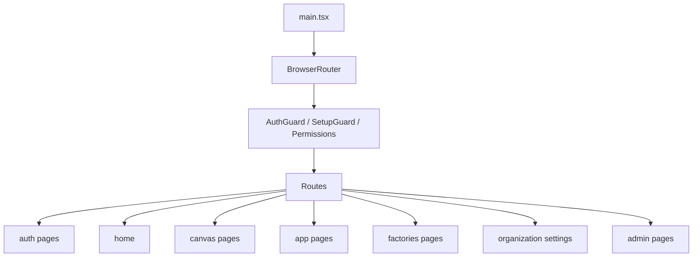
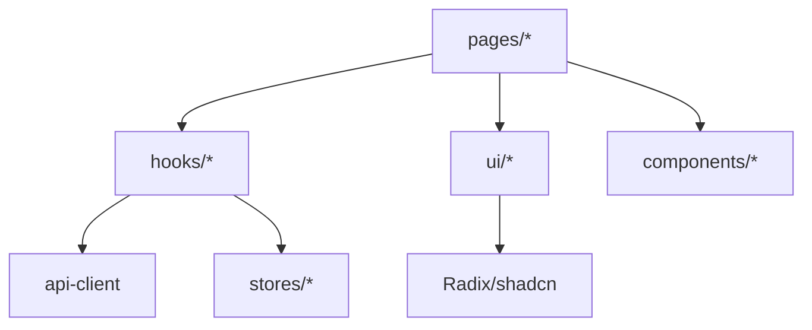
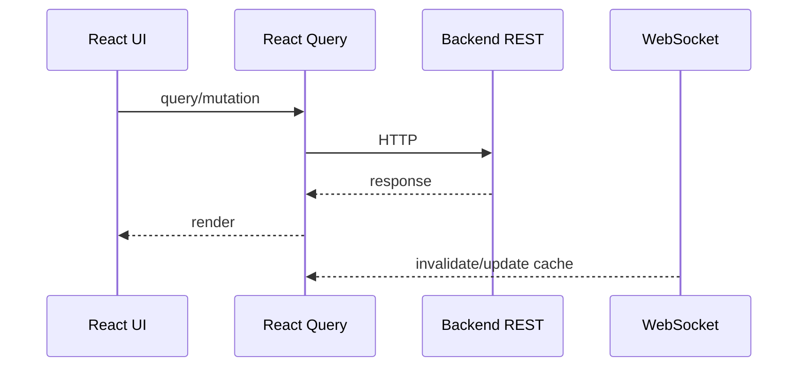

# SuperPlane 前端架构梳理（前端架构师视角）

目录：`web_src/`（Vite + React 19 + TypeScript）。

## 1. 技术栈

- 框架：React 19, React Router 8, Vite
- 数据：TanStack React Query 5（server state），Zustand 5（UI state）
- UI：Tailwind CSS 4, Radix/shadcn (`src/components/ui`, `src/ui`), Lucide icons
- 实时：WebSocket (react-use-websocket, 自定义 hooks)
- 编辑器：Monaco, TipTap, xyflow (React Flow)
- 可视化：Recharts, Mermaid
- 测试：Bun + Happy DOM；Storybook

## 2. 入口与路由

- 入口：`src/main.tsx`
- 路由：`src/App.tsx`（BrowserRouter + Routes）
- 守卫：`AuthGuard`, `SetupGuard`, `PermissionsProvider`, `RequirePermission`
- 页面分组：auth, home, canvas, app, organization, factories, admin, github

## 3. 状态管理

- Server state：TanStack Query（`QueryClient` 默认 staleTime 5min, gcTime 10min）；hooks `use*Data` 封装查询/缓存。
- UI state：Zustand stores（`stores/`）：`nodeExecutionStore`, `sidebarLayoutStore` 等。
- 全局上下文：`AccountProvider`, `ThemeProvider`, `PermissionsProvider`。
- 局部状态：组件内 useState + 回调通知父组件。

## 4. 数据获取与 API

- 生成客户端：`src/api-client/`（OpenAPI codegen，`npm run generate:api`）。
- 拦截器：`src/lib/api-interceptor.ts`。
- Hooks：`src/hooks/use*.ts` 封装 query/mutation，含 WebSocket 同步（`useCanvasWebsocket`, `useFactoryWebsocket`, `useAgentSessionWebsocket`）。

## 5. 组件分层

- `src/components/`：通用组件（AuthGuard, PermissionGate, GlobalCommandPalette 等）
- `src/ui/`：设计系统组件（button, dialog, sidebar, tabs, canvas*）
- `src/pages/`：页面级模块（canvas, app, factories, organization, admin）
- `src/hooks/`：可复用 React 逻辑
- `src/lib/`：非 React 工具函数
- `src/stores/`：Zustand stores

## 6. 实时与事件

- WebSocket hooks：`useCanvasWebsocket`, `useFactoryWebsocket`, `useAgentSessionWebsocket`, `useUserNotificationsWebsocket`
- 事件源：`src/ui/eventSource`
- 状态同步：WebSocket 事件更新 React Query cache / Zustand

## 7. 设计系统与主题

- Tailwind CSS 4 + `src/index.css`
- Radix UI primitives + shadcn-style components in `src/ui` and `src/components/ui`
- 主题：`ThemeProvider`, `themeContextState`, dark mode classes (`appDarkModeClasses`)
- Storybook 用于组件开发与可视化

## 8. 表单与交互

- shadcn components for forms（Input, Select, Dialog 等）
- Callback patterns：`(id, updates: Partial<Type>) => void`
- 本地状态 + 父通知；useEffect 同步

## 9. 可观测性与错误

- Sentry (`sentry.ts`), PostHog (`posthog.ts`), Dash0
- `usePageObservability`, page ready reporting

## 10. 构建与质量

- Vite build, tsc -b
- ESLint budget (`scripts/check-eslint-budget.mjs`)
- Bun tests (`bun test`)
- Storybook build

## 11. 关键目录速查

- `src/App.tsx` 路由入口
- `src/pages/` 页面模块
- `src/hooks/` 数据与实时 hooks
- `src/stores/` Zustand 状态
- `src/ui/` 设计系统
- `src/lib/` 工具函数
- `src/api-client/` 生成 SDK
- `src/contexts/` 全局上下文

## 12. 前后端交互

- REST/OpenAPI 网关 + 生成 TypeScript SDK
- WebSocket 事件推送
- React Query 缓存与乐观更新

